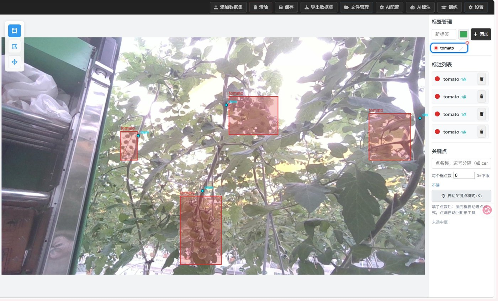

# ytlabel (keypoint annotation fork)

**Language / 语言：** [简体中文](README.md) | [English](README_en.md)

> **This repository is a personal fork of [yuturuishi/ytlabel](https://github.com/yuturuishi/ytlabel)**, based on v4.0, adding **keypoint annotation**, **switching the dataset directory at runtime**, and **YOLO pose export**. Upstream features, UI, and the MIT license are unchanged; copyright stays with the original author.

Open-source (MIT) image annotation tool: **standard annotation + keypoint annotation + dataset export**. Built with Python + Flask, cross-platform on Windows / Linux / Mac. Model training is not part of this tool — use the dedicated trainer [ytstudio](https://github.com/yuturuishi/ytstudio).

- Website: https://www.yuturuishi.com ｜ WeChat: yuturuishi
- Upstream: https://github.com/yuturuishi/ytlabel

---

## Changes in this fork

| Feature | What it does | Where |
|---|---|---|
| **Keypoint annotation** | rectangle + keypoints (bbox + kpts); fixed keypoint count per box; auto-enters point mode after drawing a box, returns to the rectangle tool when full | right panel "关键点" / shortcut `K` |
| **Dataset directory switching** | browse any directory (drive picker, go-up), one click "set as dataset"; annotations live in `<dir>/.ytlabel/` | top bar "文件管理" |
| **Startup directory** | `--data-dir` flag or `YTLABEL_DATA_DIR` env var; the choice is remembered | CLI |
| **YOLO pose export** | if any keypoint exists, export switches to pose format (`kpt_shape: [N, 3]`, labels `cls cx cy w h x y v ...`) | "导出数据集" |
| **Absolute-path uploads** | uploading / creating folders also works after switching to an external directory | "文件管理" |

Pose labels look like this (`v=2` = annotated, `0 0 0` = missing point, auto-padded):



```text
0 0.312500 0.520833 0.312500 0.625000  0.312500 0.520833 2  0.312500 0.833333 2
```

Train with ultralytics:

```bash
yolo pose train model=yolo11n-pose.pt data=<export_dir>/data.yaml epochs=100 imgsz=640 batch=4
```

> Keypoint order is semantic: point #1 must always be the same body part. Do not change the count/order mid-dataset.

---

## Features (upstream)


- **Annotation**: multiple types (rectangle, polygon, etc.); import images, videos, and LabelMe datasets
- **AI auto-labeling**: works with an LLM API you configure yourself (LMStudio, vLLM, ollama, Alibaba Cloud, etc.)
- **Dataset export**: YOLO format with a customizable train / val / test split
- **File management**: built-in file browse, upload, and download
- **Offline deployment**: all static assets localized, runs on isolated intranets
- **Model training**: not part of this tool — use [ytstudio](https://github.com/yuturuishi/ytstudio)

**Shortcuts**: `Ctrl+S` save annotations ｜ `Ctrl+Shift+D` clear annotations ｜ `K` toggle keypoint mode

---

## Screenshots


---

## Quick Start

Requirements: Python 3.9+ (tested on 3.10), a modern web browser.

```bash
# Create and activate a virtual environment
python -m venv venv
venv\Scripts\activate           # Windows
# source venv/bin/activate      # Linux / Mac

# Install dependencies
pip install -r requirements.txt -i https://pypi.tuna.tsinghua.edu.cn/simple

# Start the server
python app.py --host 0.0.0.0 --port 9924
```

Open http://127.0.0.1:9924 in your browser.

---

## Project Structure

```
ytlabel/
├── app.py                 # Main application
├── AiUtils.py             # AI auto-labeling utility class
├── requirements.txt       # Dependency list
├── config.json            # App configuration
├── settings.json          # UI settings
├── language-*.json        # Localization strings
├── ytlabel.spec           # PyInstaller build config
├── logo.ico               # App icon
├── static/                # Static assets (icons, styles, scripts, local Socket.IO)
├── templates/             # Page templates: index.html (annotation home) / ai_config.html / file_manager.html
└── uploads/               # Upload storage (created at runtime)
    ├── annotations/       # Annotation data
    ├── config/            # Config files
    └── samples/           # Annotation images
```

---

## Tech Stack

Flask + Flask-SocketIO ｜ HTML/CSS/JS ｜ OpenCV/PIL ｜ Socket.IO

---

## Version History

### v4.0 (current) — 2026/10/04
- **Built-in model training removed**: focuses on data annotation + dataset export; training moved to [ytstudio](https://github.com/yuturuishi/ytstudio)
- **Ultralytics fully removed**: deleted the `pre_models/` directory and all official YOLO weights — zero ultralytics residue in the repo
- **Renamed**: xclabel → ytlabel (incl. `ytlabel.spec`, page titles, local settings keys)
- **Bulk delete optimized**: removed O(N²) repeated annotation-table I/O, added a global loading overlay
- **Docs consolidated**: CHANGELOG merged into README; settings panel slimmed; compliance notes updated

### v3.0 — 2026/05/19
- New standalone training panel: full YOLO11 workflow, resume-from-checkpoint, model testing and download
- Training state persistence: auto-restore progress after page refresh / SocketIO reconnect
- Pretrained model dir moved to `pre_models`; Socket.IO bundled locally for offline deployment

### v2.x
- **v2.7** — 2026/01/05: annotations moved to `uploads/annotations/`, API config to `uploads/config/`
- **v2.6** — 2026/01/04: added AI auto-labeling (large models / Alibaba Cloud)
- **v2.4** — 2026/01/03: improved RTSP stream and SocketIO disconnect handling; fixed post-packaging error
- **v2.3** — 2025/12/30: added file management system (navigate, preview, batch download/delete, upload)
- **v2.2** — 2025/12/30: original vs rendered comparison after labeling, click to zoom
- **v2.1** — 2025/12/01: added YOLO11 integration; improved annotation tools, label management, dataset export
- **v2.0** — 2025/11/29: migrated Django → Flask; video frame extraction, LabelMe import, YOLO export

### v1.0 — 2025/02/17
- Basic image annotation (rectangle, polygon), Python + Django
- v1.0 branch: https://gitee.com/yuturuishi/ytlabel/tree/v1.0

---

## License

The project's own code is under the **MIT** License — keep the copyright notice to use it freely. Third-party libraries are subject to their respective licenses.

- **AI auto-labeling**: runs through an LLM API you configure yourself (LMStudio, vLLM, ollama, Alibaba Cloud — local/private services). It does **not** depend on the Ultralytics library.
- **Network requests**: only talks to local services and the local/private LLM API you configure. It does **not** send any user data, annotations, or runtime info to any external server.
- **Disclaimer**: users are responsible for the legality of their deployment environment, models, and data. ytlabel is provided "as is", without warranty.
